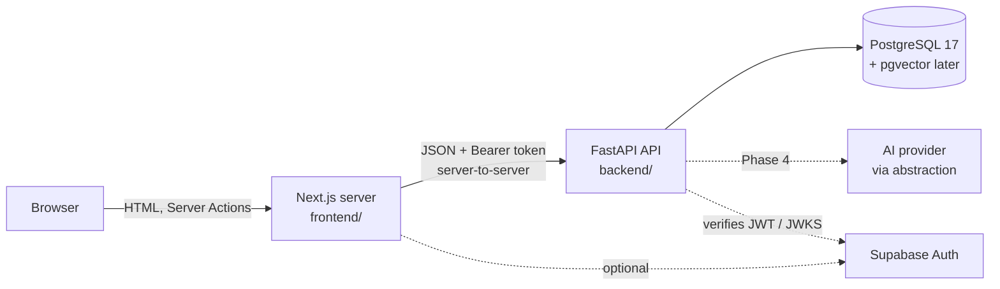

# Architecture

## Overview

BRIDGE is a **modular monolith**: one FastAPI backend and one Next.js frontend, backed by one
PostgreSQL database. Modules have clear boundaries so they can be split into services later if a
real need appears; until then, one deployable unit keeps development and operations simple for a
university team.



## Backend layering

```
app/api/        HTTP only: parse request, call a service, shape the response
app/services/   business logic (no FastAPI imports), transactions, audit entries
app/security/   tokens, passwords, permissions, rate limiting, headers, auth dependencies
app/models/     SQLAlchemy ORM models
app/schemas/    Pydantic request/response models
app/db/         engine/session, declarative base with naming conventions
app/core/       settings
```

Reserved packages (empty until their phase): `simulation/` (3), `ai/` (4), `assessment/` (5),
`recommendations/` and `knowledge/` (8).

## Architectural decisions (Phase 1)

| # | Decision | Rationale |
|---|---|---|
| AD-1 | Modular monolith, no microservices | Scope-appropriate; boundaries kept in modules |
| AD-2 | `create_app(settings)` factory, state on `app.state` | Isolated, parallel-safe tests; no hidden globals |
| AD-3 | Synchronous SQLAlchemy 2 + psycopg 3 | Simpler code and transactions; FastAPI runs sync routes in a thread pool. Revisit only with measured need |
| AD-4 | Two auth providers behind one `VerifiedIdentity` | `local` makes the platform runnable and testable without external services; `supabase` is the production path from the spec. Rest of the app is provider-agnostic |
| AD-5 | Role owned by BRIDGE DB, never by token claims | Supabase `user_metadata` is user-editable; trusting it would allow privilege escalation |
| AD-6 | Permissions defined in code, not DB tables | Reviewed, versioned, tested; avoids a configurable-RBAC subsystem nobody needs yet. Ownership rules live in services |
| AD-7 | Registration always creates students; elevated roles only via admin API or CLI | Prevents self-assigned privileges |
| AD-8 | Portable column types (`Uuid`, `JSON`→`JSONB` on PostgreSQL) | Same migrations run on PostgreSQL (target) and SQLite (fast local tests) |
| AD-9 | Tests build the schema with Alembic, not `create_all`, and check model/migration drift | Migrations are exercised on every run |
| AD-10 | Frontend as backend-for-frontend: Server Actions call the API; token in an httpOnly cookie | Token unreadable by browser JS (XSS); no cross-site cookies or browser-side CORS needed; API URL stays private |
| AD-11 | Next.js 16 with Cache Components | Current stable default; session-dependent UI streams behind `<Suspense>` |
| AD-12 | Exact dependency pins in `requirements*.lock` and `package-lock.json` | Reproducible builds; ranges in `pyproject.toml` |

## Request flow: authenticated page

1. Browser requests `/dashboard`. The static shell is served immediately (partial prerender).
2. Inside a `<Suspense>` boundary the Next.js server reads the `bridge_session` httpOnly cookie and
   calls `GET /api/v1/users/me` with `Authorization: Bearer <token>`.
3. FastAPI verifies the JWT (signature, issuer, audience, expiry), loads the user **and role from
   the database**, checks the route's permission, and responds.
4. A 401 redirects to `/login?expired=1`; other errors render the route's error boundary.

## Extensibility

New specializations are rows in `specializations`, not code. Scenarios (Phase 3) will be versioned,
schema-validated data in `scenarios/` and the database, executed by one shared engine.
