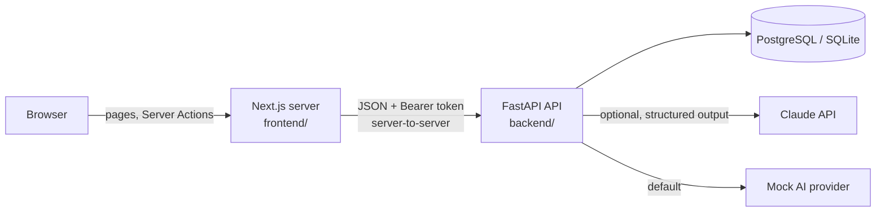
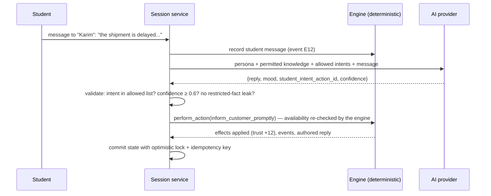

# Architecture

BRIDGE is a **modular monolith**: one FastAPI backend, one Next.js frontend, one relational database
(PostgreSQL in production, SQLite for local runs and tests).

The browser never sees the API URL or the access token: it lives in an httpOnly cookie and only the
Next.js server forwards it.

## Backend modules

| Package | Responsibility |
|---|---|
| `app/api/` | HTTP routes only (auth, users, simulation, progress, teach, admin, admin_platform) |
| `app/simulation/` | **Authoritative rules**: scenario schema, condition language, deterministic engine, loader, competency registry |
| `app/ai/` | Provider abstraction (mock, Claude), structured schemas, orchestration: limits, validation, fallbacks, usage logs |
| `app/services/` | Business logic: sessions, scenarios (versions), assessment, progress/recommendations, knowledge (retrieval), access rules, platform settings, demo data, evaluation |
| `app/security/` | Tokens, passwords, role permissions, rate limiting, security headers, auth dependencies |
| `app/models/` | SQLAlchemy models (see DATABASE.md) |

## The core rule: AI proposes, code decides

Budgets, trust, deadlines, outcomes and scores are never written by the AI. A character's
*restricted* facts are not placed in its prompt until the scenario's `reveal_when` condition holds.

## Assessment pipeline

1. Collect evidence from the event log: decisions with justifications, messages, final submissions,
   each with a stable reference (`E<seq>`).
2. Ask the assessor (Claude or mock) for one judgement per rubric criterion.
3. Validate: unknown criteria ignored; level score must be one of the rubric's levels; cited evidence
   must exist and be relevant to the criterion; otherwise the transparent rule-based evaluation is
   used for that criterion and the substitution is flagged.
4. Blend qualitative level with **objective signals** (rule conditions on final state), per the
   criterion's `objective_weight`.
5. Criteria with no evidence are marked *insufficient evidence* and excluded from the weighted total.
6. Weighted overall score computed in Python; report built; prompt-injection patterns flagged for
   professor review.

## Scenarios

YAML files in `scenarios/<specialization>/` are validated by `ScenarioDefinition` (types, ids,
cross-references, rubric weights) and synced into immutable `scenario_versions`. Professors can edit
in the UI; each save is a new version. Sessions reference the exact version they started with.

## Key decisions

| Decision | Rationale |
|---|---|
| Pure engine with no I/O | Every rule unit-testable and reproducible; AI cannot bypass it |
| JSON condition language instead of code | Scenario authors cannot execute code; conditions are validated |
| One append-only event log (instead of separate messages/tasks/submissions tables) | A single ordered evidence source for assessment and audit; state JSON is a derived snapshot |
| Optimistic locking + idempotency keys | Safe retries and concurrent tabs without database-specific locks |
| Mock provider as default | Runs anywhere for free; deterministic tests and demos |
| Structured outputs + server-side validation | AI output is data that must pass checks, never instructions |
| Lexical TF-IDF retrieval | Portable, explainable, no embedding service; pgvector is a later upgrade |
| Code-defined permissions + course membership | Reviewable RBAC; professors see only their students |
| Next.js server actions as backend-for-frontend | Token never in the browser; no CORS from browsers |
