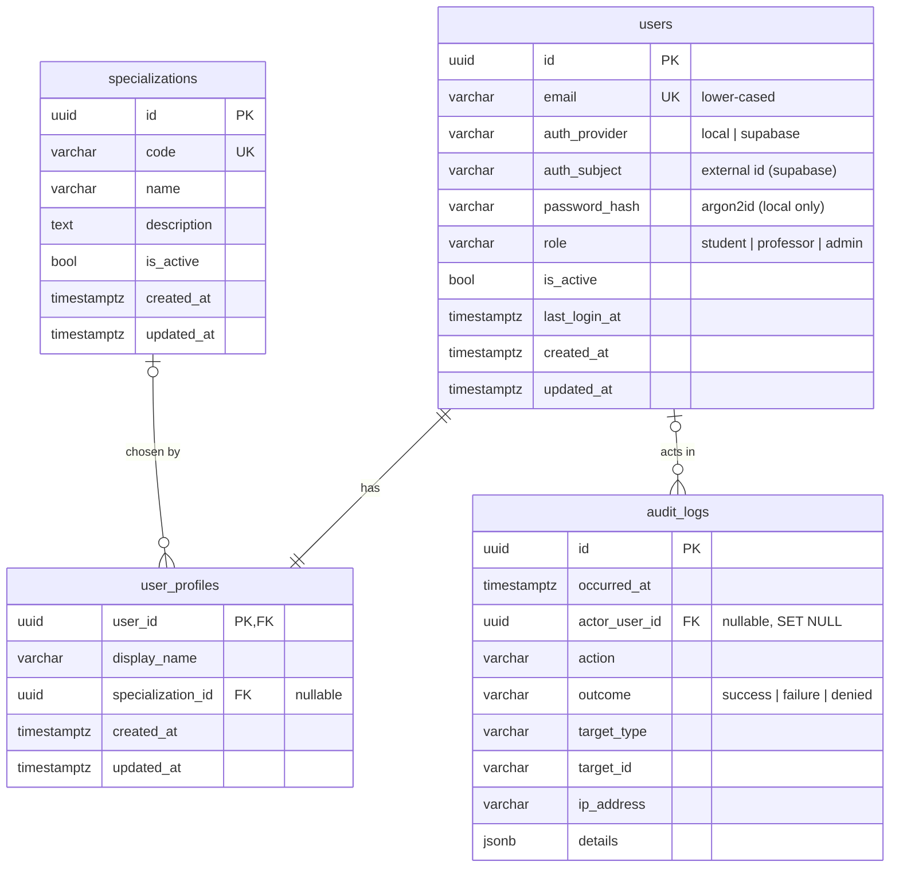

# Database

PostgreSQL 17 is the supported database. Schema changes are made only through Alembic migrations
in `backend/alembic/versions/`. SQLite is accepted for local tests only and rejected in production.

## Entity relationship diagram (Phase 1)



## Tables

| Table | Purpose | Key constraints |
|---|---|---|
| `users` | Accounts. Identity from an auth provider; role owned by BRIDGE | `email` unique; `(auth_provider, auth_subject)` unique; CHECK role/provider values; CHECK local accounts have a password hash and external accounts a subject |
| `user_profiles` | Minimal profile: display name and chosen specialization | PK = FK to `users` (cascade delete); specialization FK `SET NULL` |
| `specializations` | Academic specializations; new ones are rows, not code | `code` unique. Seeded: `translation`, `international_trade`, `infocom` (fixed UUIDs) |
| `audit_logs` | Append-only security/admin events (register, login success/failure, denied access, role changes, CLI user creation) | CHECK outcome; indexes `(actor_user_id, occurred_at)`, `(action, occurred_at)`; actor FK `SET NULL` so deleting a user keeps the history |

## Conventions
- UUID primary keys (generated by the application).
- `created_at` / `updated_at` with `timezone=True` on every mutable table.
- Deterministic constraint names (`ix_`, `uq_`, `ck_`, `fk_`, `pk_`) so migrations are reviewable.
- `details` is `JSONB` on PostgreSQL. Never store passwords, tokens or full submissions there.

## Deferred tables (added with the phase that needs them)
Courses, competencies, scenarios and scenario versions, characters, documents, events, simulation
sessions/state, student actions, messages, tasks, submissions, rubrics and rubric versions,
assessments, criterion results, reviews, competency progress, recommendations, educational
resources (+ embeddings), AI usage logs. Adding them now, before their behaviour is designed, would
create schema we would have to migrate away from.

## Migration workflow
```bash
cd backend
alembic revision --autogenerate -m "describe change"   # then review the file by hand
alembic upgrade head
pytest tests/test_migrations.py                        # models and migrations must match
```
