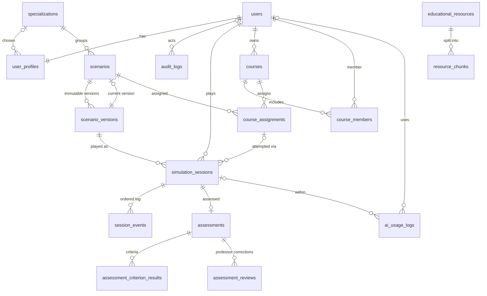

# Database

PostgreSQL 17 in production; SQLite for local runs and tests (rejected in production). The schema is
created only by Alembic migrations (`0001_foundations`, `0002_platform`); a test fails if models and
migrations drift.

## Entity relationship diagram

## Tables

| Table | Purpose |
|---|---|
| `users`, `user_profiles` | Accounts (local or Supabase identity) and minimal profile (display name, specialization). Role lives here, never in tokens. |
| `specializations` | Data-driven list; new specializations are rows. |
| `audit_logs` | Security/admin events (sign-ins, denials, role changes, reviews, uploads, settings). |
| `scenarios` | Identity, specialization, publication status, pointer to the current version. |
| `scenario_versions` | Immutable full definition (incl. rubric) + content hash + change note. |
| `simulation_sessions` | One attempt: mode, difficulty, status, outcome, authoritative `state` JSON, `state_version` for optimistic locking. |
| `session_events` | Append-only ordered events (`seq` unique per session) with optional idempotency key; the evidence source. |
| `assessments` | Provider/model, mock flag, rubric snapshot, original and final overall, flags, report JSON, status. |
| `assessment_criterion_results` | Per criterion: qualitative, objective, original and final score, evidence refs, weaknesses, improvements, uncertainty. |
| `assessment_reviews` | Professor corrections with justification (append-only). |
| `courses`, `course_members`, `course_assignments` | Teaching structure; membership authorizes professor access. |
| `educational_resources`, `resource_chunks` | Uploaded approved material, versioned by title, visibility `students`/`professors`, chunked for retrieval. |
| `ai_usage_logs` | One row per AI call or fallback: purpose, provider, model, tokens, latency, estimated cost, success, fallback, error code. No prompts or student text. |
| `platform_settings` | Admin-editable settings (never secrets). |

## Notes
- UUID primary keys; timezone-aware timestamps; deterministic constraint names.
- `scenarios.current_version_id` ↔ `scenario_versions.scenario_id` is a cycle; the FK is added after
  both tables exist in the migration and dropped first on downgrade.
- JSON columns are `JSONB` on PostgreSQL.
- Deleting a user cascades to their sessions/assessments; audit and AI logs keep `NULL` actor.
